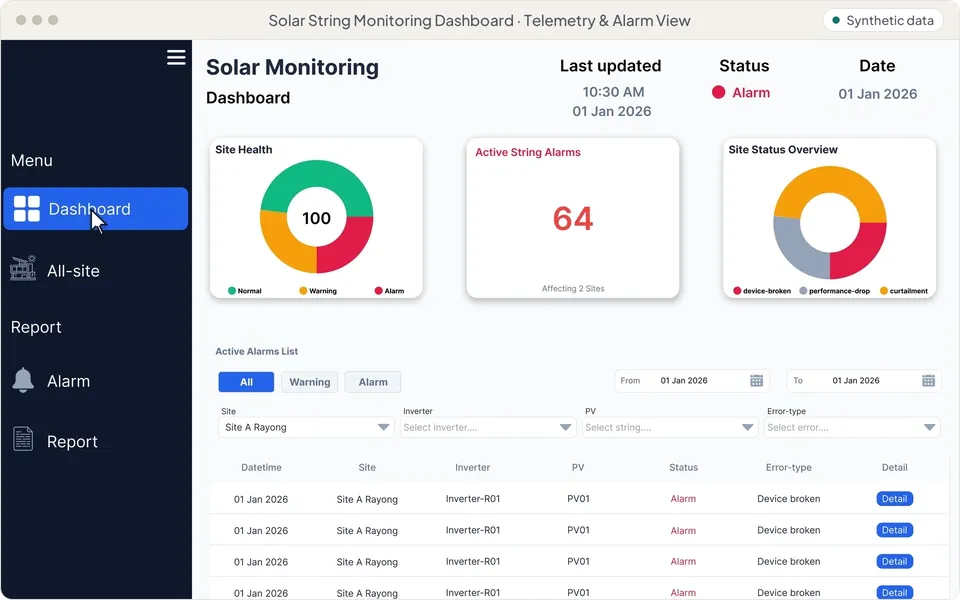
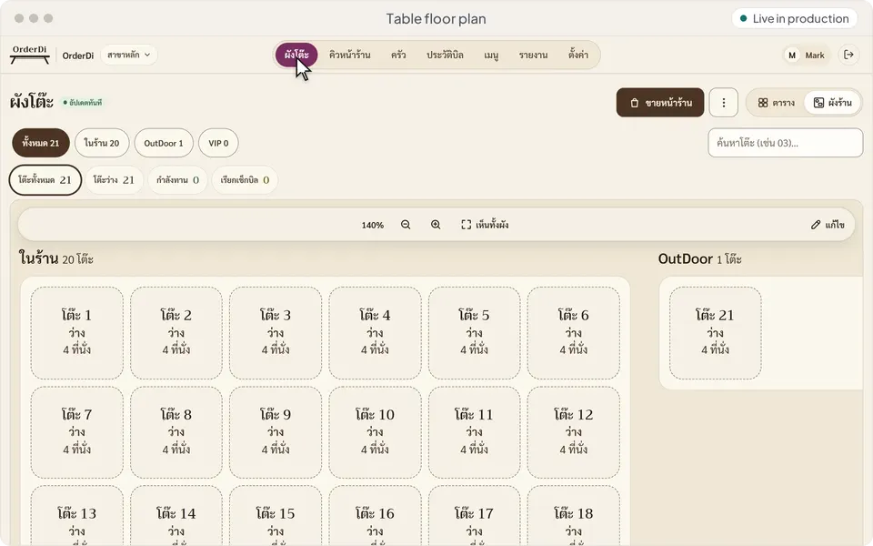

<picture>
  <source media="(prefers-color-scheme: dark)" srcset="./assets/banner-dark.svg" />
  <source media="(prefers-color-scheme: light)" srcset="./assets/banner-light.svg" />
  
</picture>

 

I build full-stack web applications and scalable backend services. My work runs from FastAPI and Spring Boot APIs to real-time monitoring dashboards with React and TypeScript.

[![LinkedIn][linkedin-badge]](https://www.linkedin.com/in/kittiphat-duangmanee-8410362b3/)

---

### Tech Stack

| Category | Technologies |
| :--- | :--- |
| **Backend** |       |
| **Frontend** |     |
| **Databases & Cache** |     |
| **DevOps & Cloud** |  ![AWS][aws-badge]  |

 

<picture>
  <source media="(prefers-color-scheme: dark)" srcset="./assets/system-flow-dark.svg" />
  <source media="(prefers-color-scheme: light)" srcset="./assets/system-flow-light.svg" />
  
</picture>

---

### Featured Projects

<table>
  <tr>
    <td width="50%" valign="top">
      <a href="https://kittiphatduangmanee.github.io/#project-solar">
        <picture>
          <source media="(prefers-reduced-motion: reduce)" srcset="./assets/solar-monitoring-ui.webp" />
          
        </picture>
      </a>
        
      <strong>Solar String Monitoring Alarm System</strong> 
      SCG Cleanergy · Application Design Intern · Nov&nbsp;2025&nbsp;to&nbsp;Mar&nbsp;2026
        
      Monitors a solar plant one string at a time. Every five minutes it collects current and voltage, compares each string with its threshold, and marks it normal, warning or alarm. A string in alarm reaches the operators by LINE and email, so nobody has to watch the dashboard.
        
      <code>Python</code> <code>FastAPI</code> <code>React</code> <code>TimescaleDB</code> <code>Redis</code> <code>LINE&nbsp;Messaging&nbsp;API</code> <code>SMTP</code>
        
      <a href="https://kittiphatduangmanee.github.io/#project-solar"><strong>Screens and architecture →</strong></a> 
      Internal enterprise system. Screens are shown with synthetic data.
    </td>
    <td width="50%" valign="top">
      <a href="https://orderdi.apps.sv-academy.org">
        <picture>
          <source media="(prefers-reduced-motion: reduce)" srcset="./assets/orderdi-pos-ui.webp" />
          
        </picture>
      </a>
        
      <strong>OrderDi</strong> 
      Restaurant order and POS platform · Full-stack web application · Live in production
        
      A point of sale for restaurants that runs in the browser. Staff open tables from a floor plan, ring up orders at the counter and keep the menu current, and the report page totals the sales as bills close. It is deployed on Cloudflare Workers, so there is no server to look after.
        
      <code>Hono</code> <code>TypeScript</code> <code>Tailwind&nbsp;CSS</code> <code>Drizzle&nbsp;ORM</code> <code>CockroachDB</code> <code>Cloudflare&nbsp;Workers</code>
        
      <a href="https://orderdi.apps.sv-academy.org"><strong>Visit live app →</strong></a> &nbsp;·&nbsp; <a href="https://kittiphatduangmanee.github.io/#project-orderdi"><strong>Screens and architecture →</strong></a>
    </td>
  </tr>
</table>

---

### Certifications

Four documents, labelled as what they are. Open any of them to read the original PDF.

| Certificate | Type | Issued by | Date |
| :--- | :--- | :--- | :--- |
| [AWS Cloud Practitioner Essentials](https://kittiphatduangmanee.github.io/certificates/aws-cloud-practitioner-essentials.pdf) | Course completion certificate | AWS Training & Certification | 3&nbsp;Nov&nbsp;2026 |
| [Security Engineer Training Program](https://kittiphatduangmanee.github.io/certificates/depa-security-engineer.pdf) | Training certificate · 60&nbsp;hours | depa with ARIT | 14&nbsp;Nov&nbsp;2025 |
| [Security Engineer Program, Selected Participant](https://kittiphatduangmanee.github.io/certificates/arit-security-engineer.pdf) | Selection certificate | ARIT Co., Ltd. | 14&nbsp;Nov&nbsp;2025 |
| [IT Specialist: Cybersecurity](https://kittiphatduangmanee.github.io/certificates/its-cybersecurity.pdf) | Exam based certification | Certiport, a Pearson VUE business | 27&nbsp;Nov&nbsp;2025 |

<!-- Simple Icons no longer ships the AWS or LinkedIn marks, so these two badges carry their logo as inline SVG data, drawn from the portfolio's own icon paths. -->
[aws-badge]: https://img.shields.io/badge/AWS-232F3E?style=flat-square&logo=data%3Aimage%2Fsvg%2Bxml%3Bbase64%2CPHN2ZyB4bWxucz0iaHR0cDovL3d3dy53My5vcmcvMjAwMC9zdmciIHZpZXdCb3g9IjAgMCAyNCAyNCI%2BPHBhdGggZmlsbD0iI2ZmZiIgZD0iTTYuOCAxMGMwIC4zIDAgLjUgLjEgLjcgLjEgLjIgLjEgLjQgLjMgLjYgMCAuMSAuMSAuMSAuMSAuMiAwIC4xIDAgLjItLjIgLjJsLS41IC4zYS40IC40IDAgMCAxLS4yIC4xYy0uMSAwLS4yIDAtLjItLjFhMi41IDIuNSAwIDAgMS0uMy0uNCA2LjIgNi4yIDAgMCAxLS4yLS41Yy0uNiAuNy0xLjQgMS4xLTIuMyAxLjEtLjcgMC0xLjItLjItMS42LS42LS40LS40LS42LS45LS42LTEuNSAwLS43IC4yLTEuMiAuNy0xLjYgLjUtLjQgMS4xLS42IDItLjYgLjMgMCAuNiAwIC44IC4xIC4zIDAgLjYgLjEgLjkgLjJ2LS42YzAtLjYtLjEtMS0uNC0xLjMtLjMtLjItLjctLjQtMS4zLS40LS4zIDAtLjYgMC0uOSAuMS0uMyAuMS0uNiAuMi0uOSAuM2EyLjMgMi4zIDAgMCAxLS4zIC4xIC41IC41IDAgMCAxLS4xIDBjLS4xIDAtLjItLjEtLjItLjJ2LS40YzAtLjEgMC0uMiAuMS0uM2EuNiAuNiAwIDAgMSAuMi0uMmMuMy0uMSAuNi0uMyAxLS40YTQuOCA0LjggMCAwIDEgMS4yLS4yYy45IDAgMS42IC4yIDIuMSAuNiAuNCAuNCAuNyAxLjEgLjcgMnYyLjZ6bS0zLjIgMS4yYy4zIDAgLjUgMCAuOC0uMSAuMy0uMSAuNS0uMyAuOC0uNSAuMS0uMiAuMi0uMyAuMy0uNSAwLS4yIC4xLS40IC4xLS43di0uM2E2LjcgNi43IDAgMCAwLS43LS4xIDYgNiAwIDAgMC0uOCAwYy0uNSAwLS45IC4xLTEuMiAuMy0uMyAuMi0uNCAuNS0uNCAuOSAwIC40IC4xIC43IC4zIC44IC4yIC4yIC41IC4zIC44IC4zem02LjQgLjljLS4xIDAtLjIgMC0uMy0uMS0uMSAwLS4xLS4yLS4yLS4zTDcuNiA1LjVhMS40IDEuNCAwIDAgMS0uMS0uM2MwLS4xIC4xLS4yIC4yLS4yaC44Yy4yIDAgLjMgMCAuMyAuMSAuMSAwIC4xIC4yIC4yIC4zbDEuMyA1LjMgMS4yLTUuM2MwLS4yIC4xLS4zIC4yLS4zYS41IC41IDAgMCAxIC4zLS4xaC42Yy4yIDAgLjMgMCAuMyAuMSAuMSAwIC4xIC4yIC4yIC4zbDEuMyA1LjMgMS40LTUuM2MwLS4yIC4xLS4zIC4yLS4zYS41IC41IDAgMCAxIC4zLS4xaC43Yy4xIDAgLjIgLjEgLjIgLjIgMCAwIDAgLjEgMCAuMWExLjEgMS4xIDAgMCAxLS4xIC4ybC0xLjkgNi4yYzAgLjItLjEgLjMtLjIgLjNhLjUgLjUgMCAwIDEtLjMgLjFoLS43Yy0uMiAwLS4zIDAtLjMtLjEtLjEtLjEtLjEtLjItLjEtLjNsLTEuMi01LjEtMS4yIDUuMWMwIC4yLS4xIC4zLS4xIC4zLS4xIC4xLS4yIC4xLS4zIC4xem0xMC4zIC4yYy0uNCAwLS44IDAtMS4yLS4xLS40LS4xLS43LS4yLS45LS4zLS4xLS4xLS4yLS4yLS4yLS4yYS42IC42IDAgMCAxIDAtLjJ2LS40YzAtLjIgLjEtLjIgLjItLjIgMCAwIC4xIDAgLjEgMCAwIDAgLjEgMCAuMiAuMSAuMyAuMSAuNiAuMiAuOSAuMyAuMyAuMSAuNiAuMSAuOSAuMSAuNSAwIC45LS4xIDEuMi0uM2EuOSAuOSAwIDAgMCAuNC0uOCAuOCAuOCAwIDAgMC0uMi0uNmMtLjEtLjItLjQtLjMtLjgtLjRsLTEuMi0uNGMtLjYtLjItMS0uNS0xLjMtLjhhMS45IDEuOSAwIDAgMS0uNC0xLjJjMC0uMyAuMS0uNiAuMi0uOSAuMS0uMyAuMy0uNSAuNi0uNyAuMi0uMiAuNS0uMyAuOC0uNCAuMy0uMSAuNy0uMSAxLS4xIC4yIDAgLjQgMCAuNSAwIC4yIDAgLjMgLjEgLjUgLjEgLjIgMCAuMyAuMSAuNSAuMSAuMSAwIC4zIC4xIC4zIC4xYS43IC43IDAgMCAxIC4yIC4yIC40IC40IDAgMCAxIC4xIC4zdi40YzAgLjItLjEgLjMtLjIgLjNhLjggLjggMCAwIDEtLjMtLjEgMy43IDMuNyAwIDAgMC0xLjUtLjNjLS41IDAtLjggLjEtMS4xIC4yLS4yIC4yLS40IC40LS40IC43IDAgLjIgLjEgLjQgLjIgLjYgLjIgLjIgLjUgLjMgLjkgLjRsMS4xIC40Yy42IC4yIDEgLjQgMS4yIC44IC4yIC4zIC40IC43IC40IDEuMSAwIC4zLS4xIC43LS4yIC45LS4xIC4zLS4zIC41LS42IC43LS4yIC4yLS41IC4zLS45IC40LS40IC4xLS43IC4yLTEuMSAuMnpNMjEuNyAxNi4yYy0yLjYgMS45LTYuNCAzLTkuNyAzLTQuNiAwLTguNy0xLjctMTEuOS00LjUtLjItLjIgMC0uNSAuMy0uNCAzLjQgMiA3LjYgMy4yIDExLjkgMy4yIDIuOSAwIDYuMS0uNiA5LjEtMS45IC40LS4yIC44IC4zIC40IC42ek0yMi44IDE1Yy0uMy0uNC0yLjItLjItMy4xLS4xLS4zIDAtLjMtLjItLjEtLjQgMS41LTEuMSA0LS44IDQuMy0uNCAuMyAuNC0uMSAyLjgtMS41IDQtLjIgLjItLjQgLjEtLjMtLjIgLjMtLjggMS0yLjYgLjctM3oiLz48L3N2Zz4%3D
[linkedin-badge]: https://img.shields.io/badge/LinkedIn-Kittiphat_Duangmanee-0A66C2?style=flat-square&logo=data%3Aimage%2Fsvg%2Bxml%3Bbase64%2CPHN2ZyB4bWxucz0iaHR0cDovL3d3dy53My5vcmcvMjAwMC9zdmciIHZpZXdCb3g9IjAgMCAyNCAyNCI%2BPHBhdGggZmlsbD0iI2ZmZiIgZD0iTTIwLjQgMjAuNWgtMy42di01LjZjMC0xLjMgMC0zLTEuOS0zLTEuOSAwLTIuMSAxLjQtMi4xIDIuOXY1LjdIOS40VjloMy40djEuNmgwYy41LS45IDEuNi0xLjkgMy40LTEuOSAzLjYgMCA0LjMgMi40IDQuMyA1LjV2Ni4zek01LjMgNy40YTIuMSAyLjEgMCAwIDEtMi4xLTIuMSAyLjEgMi4xIDAgMSAxIDIuMSAyLjF6bTEuOCAxM0gzLjZWOWgzLjZ2MTEuNXpNMjIuMiAwSDEuOEMuOCAwIDAgLjggMCAxLjd2MjAuNUMwIDIzLjIgLjggMjQgMS44IDI0aDIwLjVDMjMuMiAyNCAyNCAyMy4yIDI0IDIyLjNWMS43QzI0IC44IDIzLjIgMCAyMi4yIDBoMHoiLz48L3N2Zz4%3D
